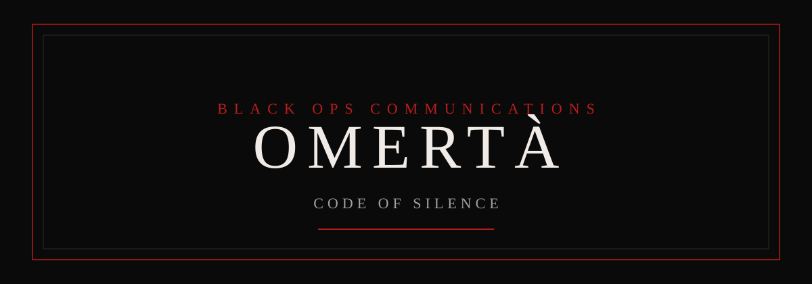

<p align="center">
  
</p>

<p align="center">
  
</p>

<p align="center">
  <a href="https://synchancybersecurity.github.io/Omerta/"></a>
  &nbsp;
  
  &nbsp;
  
  &nbsp;
  
  &nbsp;
  
</p>

# Omertà

Omertà is a communications app for people who use a handle instead of a real name. It runs in the browser and can live on a phone home screen.

Open chats, unlocked rooms, posts, and auctions are shared, so every phone sees the same ones. Private messages stay between the two handles. They are sealed end to end before they are stored, and they are not published. The vault on the phone is also sealed with AES. Passphrases never leave the device.

**Live app:** [synchancybersecurity.github.io/Omerta](https://synchancybersecurity.github.io/Omerta/)

## What you get

Each person signs in with a handle and a passphrase. A new pair creates an account on that device. The same pair opens it again later. The handle is not case sensitive, including when the app looks up a conversation, a private message, or an escrow. The passphrase is case sensitive.

The interface is one dark room with a bottom bar. Sections stay available without a page reload. When a message, post, bid, or room changes, the open screen updates on its own. You do not have to leave and come back to see something new.

| Section | What it is for |
|---|---|
| Profile | Your handle, a portrait you upload, and the posts you publish. |
| News | The shared feed. A post can include writing, a picture, a video, or a file. |
| Chat | The Lounge and any rooms. Open rooms are shared. Locked rooms keep their messages on the phone. |
| Message | Private conversations between two handles. Always end to end encrypted. |
| Contacts | Search for a handle and start a private thread. |
| Escrow | Hold an amount between two handles until it is released, disputed, refunded, or cancelled. |
| MRKT | An auction desk in the style of a public sale. List a lot, bid, buy it now, or watch the clock. |
| Settings | Display, notification, and account preferences for this device. Administrators also find the house books here. |

## Chat rooms

The Lounge is open to every handle. Any member may create another room and name it. A room may be left open, or locked with its own passphrase. An open room is part of the public board. A locked room can be seen by name on other phones, but its messages stay on the phone where they were written.

The creator can always return to a room they locked. Everyone else must enter the passphrase. A locked room does not hide the room name. It only keeps the conversation behind the passphrase.

All chat rooms, including locked rooms and the Lounge, are cleared every 48 hours. The room names remain. The messages do not. Private conversations, posts, and market lots are not part of that clear.

Inside a room you can reply to a message, attach a picture or a file, or wrap the text in the emoji cipher before it is sent. The cipher is a disguise for the text. It is separate from the AES seal on the stored vault.

## Messages, posts, and files

Private messages and room messages appear as soon as they are sent. You do not have to leave the thread and come back.

A post or a private message can carry a picture, a video, or another file. There is no size cap inside the app. The phone can still run out of space, and a very large clip can take a moment while it is sealed. Profile portraits are pictures you choose yourself. A picture or a clip in the vault does not travel to another phone. The writing does, when the message itself is public.

A private message is sealed end to end between the two handles before it is stored. Each handle has its own key, kept on that phone. What is saved is ciphertext. The sender and the other handle can both read it. Nobody else is given the text. A private text message is sealed the same way. This is not a switch. It is on for every private thread. Older private messages already on the phone are sealed the next time the app opens.

The lounge, unlocked rooms, and posts stay readable by everyone. That is the public board, and it is public on purpose.

An emoji locked message stays disguised until someone holds it. That person may hold it open twice. After the second time, the message burns and is replaced with a burned notice. It is not restored. A message marked to burn after it is read does the same once it has been read.

If the phone tells the app that the signed in person took a screenshot, printed the page, or started a screen recording, the lounge writes a line with that person's name. The same names stay listed at the top of the chat. A capture the phone keeps to itself cannot be named.

## The market

MRKT is an auction desk priced in bitcoin. A seller lists a lot with a title, a description, a category, an opening price in bitcoin, and an optional buy now price. A photograph can be attached to the listing. The clock shows how much time is left.

Anyone may bid, buy the lot outright when buy now is offered, or watch it. A bid must beat the current price. A seller cannot bid on their own lot. When the clock ends, the high bid wins. If nobody bids, the lot simply ends.

## The public board

The lounge, unlocked rooms, posts, and auctions are shared. A phone publishes that public board and reads what other phones have published, so everyone sees the same open chats and the same lots. It catches up about every eight seconds.

A locked room can be seen by name. Its messages stay on the phone where they were written. A private message stays between the two handles and is not published. Passphrases, the house wallet, and the recovery phrase are not published either. A picture or a clip kept in the vault does not travel with the board. The text does.

## Escrow and the house

Escrow holds a bitcoin amount between two handles. It can be released, disputed, refunded, or cancelled.

The house keeps 3 percent of every escrow, every bid, and every auction sale. A refund or a cancelled deal does not give that cut back. The rate is fixed. Prices, bids, escrow amounts, and the house books are stored in bitcoin. Every one of those figures is also shown in dollars, using the current bitcoin price. The dollar number is a quote. The coins that move are bitcoin.

When a payer approves the transfer, that bitcoin is sent to the house wallet. The payer still has to approve it in their own bitcoin wallet. Omertà does not hold anyone else's key, and it cannot pull coins out of a wallet that has not signed. A cut smaller than the bitcoin dust limit stays on the books until it can be sent.

Older dollar amounts already on this phone are converted once, at the bitcoin price when the app next opens. After that, everything new is entered in bitcoin.

An administrator can enter one or more bitcoin addresses and export some or all of the bitcoin from the house wallet. Leave the amount blank to export the whole balance. A little bitcoin is kept back to pay the network fee.

## Recovery

In House Escrow, an administrator can show the recovery phrase and write it down somewhere that is not the phone. After the app is wiped, sign in as an administrator and paste that phrase into Restore house wallet. The same bitcoin address comes back, and the bitcoin that was already there can be exported again.

The phrase does not bring back private messages or files. Those stay on the phone where they were written. Open posts and auctions can appear again from the public board if another phone still has them. A wallet created before phrases existed shows a recovery key instead of twelve words. That key restores the same way.

## Security

The browser vault is encrypted with AES 256 GCM before it is written to device storage. Someone reading the saved file sees ciphertext, not the messages, handles, or passphrases. Pictures, clips, and other files are sealed the same way and stored beside the vault, not inside one giant text file.

The key that opens the message vault stays on the same device. It is not published in this repository, and the house recovery phrase does not open it. Clearing the browser site data removes the vault. Private messages on that phone go with it. There is no way to fetch those private messages from another machine.

The public board is the exception. Open chats, unlocked rooms, posts, and auctions are readable by anyone using Omertà, because that board is public on purpose. Two phones still do not share passphrases or private threads.

## Dead man's switch

In Settings, every handle can turn on the dead man's switch. Turning it on asks for confirmation first. Choose 1 to 7 days. When that time is up, the app deletes that handle's messages, posts, auctions, bids, rooms they created, and the rest of their stored info. The handle and passphrase stay, so they can sign in again. If the switch is still on, it arms again for the same number of days. Turning it off cancels the countdown. Nothing is deleted when you turn it off.

Public posts and auctions removed by the switch are dropped on other phones too. Private messages are removed on the phone where they were stored.

## Install

Omertà can be added to a phone home screen.

| Platform | Steps |
|---|---|
| iPhone | Open the link in Safari. Tap Share, then Add to Home Screen. |
| Android | Open the link in Chrome. Use the browser menu, then Add to Home screen or Install app. |

The icon is the coin. The name is Omertà. After an update, close the app completely and open it again.

## Accounts

Sign in with the handle and passphrase saved on that device. If the passphrase does not match an existing handle, the screen says so. It does not pretend the attempt is a new account.

Account details are private to the device. This document does not list them.

## Local development

```bash
npm install
npm run dev
```

The build published to GitHub Pages:

```bash
npm run build:pages
```

## Legacy server

The original Express program is preserved in the `original` folder, including the database layer, Docker, and the Termux notes. Its database is also sealed with AES. The key remains on the machine that runs the server and is not stored in this repository.

GitHub Pages serves the browser app only. It does not keep that process running. If you start the legacy server, run it on a machine you control and do not expose the shell to the public internet.
